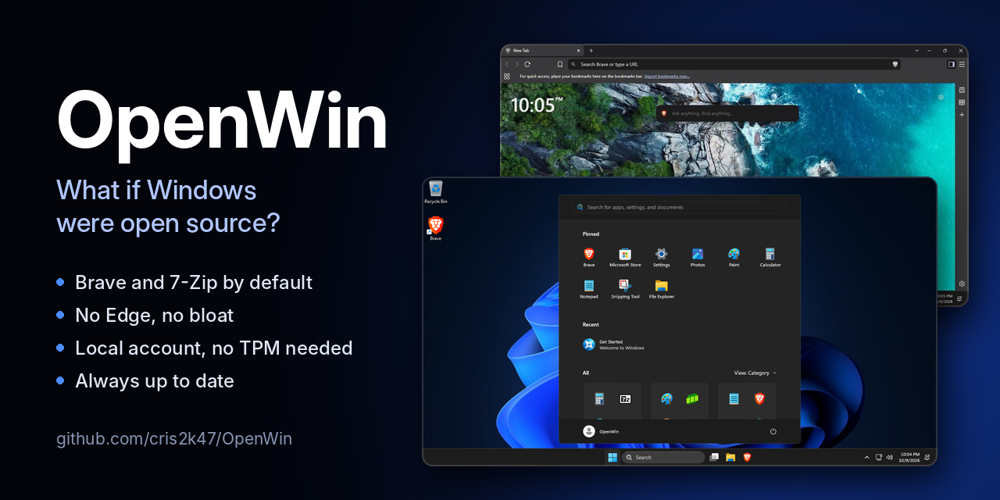
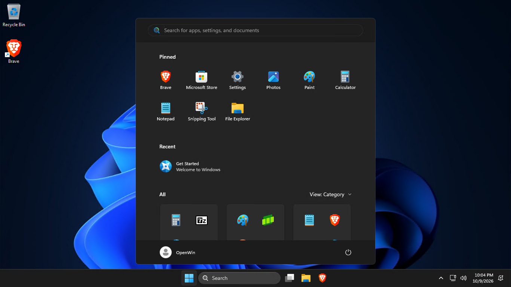
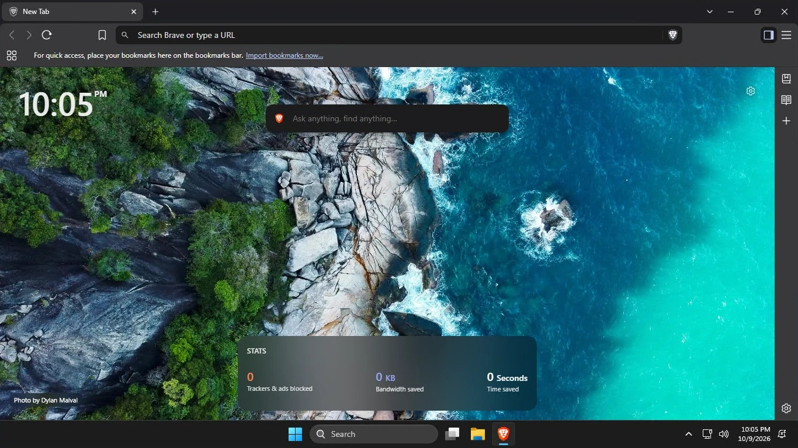

OpenWin installs Windows 11 the way an open-source operating system would ship:
open-source apps out of the box, without most of the preinstalled apps, and with
a local account instead of a Microsoft account.

It's an answer file for Windows Setup (`autounattend.xml`) plus an `$OEM$`
folder with everything it installs. You add them to the official Windows 11
installer from Microsoft, either on a USB drive or in a virtual machine.

It comes in four editions: with Brave, with Google Chrome, with Microsoft Edge,
or with Vivaldi. The Brave, Chrome and Vivaldi editions uninstall Edge.

## Downloads

| Edition | For a USB drive made with the Media Creation Tool | For a virtual machine |
| --- | --- | --- |
| Brave | [**OpenWin-Brave.zip**](https://github.com/cris2k47/OpenWin/releases/latest/download/OpenWin-Brave.zip) | [**autounattend-Brave.iso**](https://github.com/cris2k47/OpenWin/releases/latest/download/autounattend-Brave.iso) |
| Chrome | [**OpenWin-Chrome.zip**](https://github.com/cris2k47/OpenWin/releases/latest/download/OpenWin-Chrome.zip) | [**autounattend-Chrome.iso**](https://github.com/cris2k47/OpenWin/releases/latest/download/autounattend-Chrome.iso) |
| Edge | [**OpenWin-Edge.zip**](https://github.com/cris2k47/OpenWin/releases/latest/download/OpenWin-Edge.zip) | [**autounattend-Edge.iso**](https://github.com/cris2k47/OpenWin/releases/latest/download/autounattend-Edge.iso) |
| Vivaldi | [**OpenWin-Vivaldi.zip**](https://github.com/cris2k47/OpenWin/releases/latest/download/OpenWin-Vivaldi.zip) | [**autounattend-Vivaldi.iso**](https://github.com/cris2k47/OpenWin/releases/latest/download/autounattend-Vivaldi.iso) |

Each contains the same two things, `autounattend.xml` and the `$OEM$` folder,
and always ships the latest 7-Zip, plus the latest Brave, Chrome or Vivaldi in
those editions (see [Always up to date](#always-up-to-date)).

## What you get

| The Start menu and taskbar in the Brave edition | Brave's New Tab page |
| --- | --- |
|  |  |

**Open-source apps by default**
- **Brave** is the default browser and PDF viewer in the Brave edition, pinned
  to the Start menu and taskbar, and follows the Windows display language. It
  skips its welcome page the first time it opens, and each user starts with
  these settings, which they can change later in Brave's settings:
  - No Brave VPN, Leo AI, Wallet or Rewards buttons, and no Leo AI, Brave Talk
    or Wallet in the sidebar.
  - No Leo suggestions in the address bar or Leo items in the right-click menu,
    and no Brave Commands suggestions.
  - A New Tab page with a clock, without sponsored images, Brave News or the
    Rewards, Talk and VPN widgets.
  - Downloads go straight to the Downloads folder without asking where.
  - Brave's anonymous usage statistics (P3A) are off.
- **7-Zip** opens archives and disk images: zip, 7z, rar, tar, gz, xz, zst,
  iso, cab, wim, vhd(x), dmg and more.

**In the Chrome edition**
- **Google Chrome** replaces Brave as the default browser and PDF viewer, in
  the Start menu and on the taskbar. Chrome itself keeps all its default
  settings.

**In the Edge edition**
- **Microsoft Edge** stays installed instead of Brave, as Windows ships it,
  pinned to the Start menu and taskbar. It skips its welcome screens the first
  time it opens and doesn't prompt you to use its recommended browser settings.
  Each user starts with these settings, which they can change later in Edge's
  settings:
  - No Copilot button on the toolbar.
  - The Downloads button is always shown.

**In the Vivaldi edition**
- **Vivaldi** replaces Brave as the default browser and PDF viewer, in the Start
  menu and on the taskbar. It skips its welcome wizard the first time it opens.
  Otherwise Vivaldi keeps all its default settings.

**No bloat**
- Microsoft Edge is uninstalled, except in the Edge edition.
- These preinstalled apps are removed: Clipchamp, Clock, Camera, Copilot,
  Dev Home, Family, Feedback Hub, Get Help, Microsoft 365 Copilot, Microsoft
  Bing, News, Outlook (new), Phone Link, Power Automate, Quick Assist, Solitaire
  Collection, Sound Recorder, Sticky Notes, Teams, To Do, Weather, Widgets and
  Xbox.
- OneDrive is removed.
- The Start menu pins only the edition's browser (Brave, Chrome, Edge or Vivaldi),
  Microsoft Store, Settings, Photos, Paint, Calculator, Notepad, Snipping Tool
  and File Explorer, and the taskbar pins only File Explorer and the browser.
- No web suggestions in Search.

**Sensible defaults**
- Dark theme and the classic right-click menu.
- File Explorer opens to This PC and shows file extensions and hidden files.
- Mouse acceleration is off.

**Easier setup**
- Works on PCs without TPM 2.0, Secure Boot or 4 GB of RAM.
- Uses a local account: no Microsoft account and no internet connection needed.
- Skips the privacy settings screen, leaving its optional settings off.

## Install from a USB drive

1. Make a Windows 11 USB drive with the [Media Creation Tool](https://www.microsoft.com/software-download/windows11).
2. Download [OpenWin-Brave.zip](https://github.com/cris2k47/OpenWin/releases/latest/download/OpenWin-Brave.zip),
   [OpenWin-Chrome.zip](https://github.com/cris2k47/OpenWin/releases/latest/download/OpenWin-Chrome.zip),
   [OpenWin-Edge.zip](https://github.com/cris2k47/OpenWin/releases/latest/download/OpenWin-Edge.zip) or
   [OpenWin-Vivaldi.zip](https://github.com/cris2k47/OpenWin/releases/latest/download/OpenWin-Vivaldi.zip) and extract it.
3. Copy `autounattend.xml` and the `$OEM$` folder to the root of the USB drive,
   next to `setup.exe`.
4. Boot the PC from the USB drive.

## Install in a virtual machine

1. Download the Windows 11 ISO from [Microsoft](https://www.microsoft.com/software-download/windows11)
   and [autounattend-Brave.iso](https://github.com/cris2k47/OpenWin/releases/latest/download/autounattend-Brave.iso),
   [autounattend-Chrome.iso](https://github.com/cris2k47/OpenWin/releases/latest/download/autounattend-Chrome.iso),
   [autounattend-Edge.iso](https://github.com/cris2k47/OpenWin/releases/latest/download/autounattend-Edge.iso) or
   [autounattend-Vivaldi.iso](https://github.com/cris2k47/OpenWin/releases/latest/download/autounattend-Vivaldi.iso).
2. Create the virtual machine with at least 2 CPUs and the Windows 11 ISO as its
   boot CD/DVD drive. Windows 11 Setup refuses machines with a single CPU.
3. Add a second CD/DVD drive with `autounattend-Brave.iso`, `autounattend-Chrome.iso`,
   `autounattend-Edge.iso` or `autounattend-Vivaldi.iso`.
4. Start the virtual machine and press a key when it says *Press any key to boot
   from CD or DVD*. Windows Setup finds `autounattend.xml` on the second drive
   by itself.

Tips for some hypervisors:
- **VirtualBox**: turn off VirtualBox's own unattended installation when you
  create the machine: untick *Proceed with Unattended Installation* (VirtualBox
  7.2 and later) or tick *Skip Unattended Installation* (7.0 and 7.1).
  Otherwise VirtualBox installs Windows with its own answer file and OpenWin is
  ignored. Then add the second drive in *Settings → Storage*.
- **VMware Workstation**: choose *I will install the operating system later*
  to avoid Easy Install, then add the second CD/DVD drive.
- **Hyper-V**: use a Generation 2 machine and add the second DVD drive to its
  SCSI controller.
- **virt-manager / QEMU**: add a second CDROM device.

## What Setup still asks you

- Your language, time format and keyboard.
- Which edition of Windows 11 to install, such as Home or Pro, unless the PC
  has a license in its firmware (see [Activation](#activation)).
- Where to install Windows. **Setup can erase the drive you pick, so back up first.**
- Your region and keyboard layout.
- On a PC without a wired connection, a Wi-Fi network. Choose *I don't have
  internet* to stay offline.
- A name and password for your account, plus three security questions if you
  set a password.

## Activation

Setup doesn't ask for a product key. It lets you choose which edition of
Windows 11 to install instead. A PC that came with Windows usually has a license
in its firmware, and Setup then installs that license's edition without asking.

Windows activates on its own once it's online if the PC has a license for the
edition installed, either in its firmware or as a digital license from an
earlier Windows 10 or 11. Otherwise, enter a product key in
*Settings → System → Activation*.

## Always up to date

Every 5 minutes, a [GitHub Actions workflow](.github/workflows/update-installers.yml)
checks for new releases of Brave, Google Chrome, Vivaldi and 7-Zip. When one is
out, it verifies the official installer, commits the update to this repository
and publishes a new release with the downloads above. It checks Brave's
installer against the checksums Brave signs, Chrome's against Google's digital
signature (Google doesn't publish checksums), Vivaldi's against Vivaldi's
digital signature, and 7-Zip's against the checksum GitHub lists for it.

Brave's, Chrome's and Vivaldi's offline installers are larger than GitHub's
100 MB file limit, so this repository keeps only their versions, download links
and checksums, in `Brave.json`, `Chrome.json` and `Vivaldi.json`. The downloads
above include the installers themselves. Edge comes with Windows and updates itself.

Changes are tested on the [dev](https://github.com/cris2k47/OpenWin/tree/dev)
branch first. Each push there builds every edition and attaches them to its
workflow run in GitHub Actions, without publishing a release.

## Repository layout

```
$OEM$/                    Files for every edition
  $$/Setup/Scripts/       Scripts that run during setup
  $$/Setup/Files/         7-Zip installer and registry tweaks
Brave/                    The Brave edition
  autounattend.xml        Answer file for Windows Setup
  $OEM$/$$/Setup/Files/   Brave.json
  $OEM$/$$/Setup/Scripts/ RemoveEdge.cmd, which uninstalls Edge
  $OEM$/$$/System32/      Default apps
  $OEM$/$1/Users/Default/ Brave settings, Start menu and taskbar layout
Chrome/                   The Chrome edition, laid out like Brave's, without browser settings
Edge/                     The Edge edition: its answer file, default apps, Edge settings,
                          Start menu and taskbar layout
Vivaldi/                  The Vivaldi edition, laid out like Brave's
.github/                  The workflow that keeps everything up to date
docs/                     Screenshots and the banner for this README
```

Each edition's `$OEM$` folder is added to the shared one.

Windows Setup copies `$OEM$\$$` to `C:\Windows` and `$OEM$\$1` to `C:\`.

## License

OpenWin is under the [MIT License](LICENSE). Brave, Chrome, Vivaldi and 7-Zip,
which it installs, keep their own licenses.

## Credits

- [Brave](https://brave.com/) by Brave Software, under the Mozilla Public License 2.0.
- [Google Chrome](https://www.google.com/chrome/) by Google, under the [Google Chrome Terms of Service](https://www.google.com/chrome/terms/).
- [Vivaldi](https://vivaldi.com/) by Vivaldi Technologies, under the [Vivaldi End User License Agreement](https://vivaldi.com/privacy/vivaldi-end-user-license-agreement/).
- [7-Zip](https://www.7-zip.org/) by Igor Pavlov, under the GNU LGPL with the unRAR restriction.

Windows is a trademark of Microsoft. OpenWin isn't affiliated with Microsoft,
Brave Software, Google, Vivaldi Technologies or 7-Zip.
